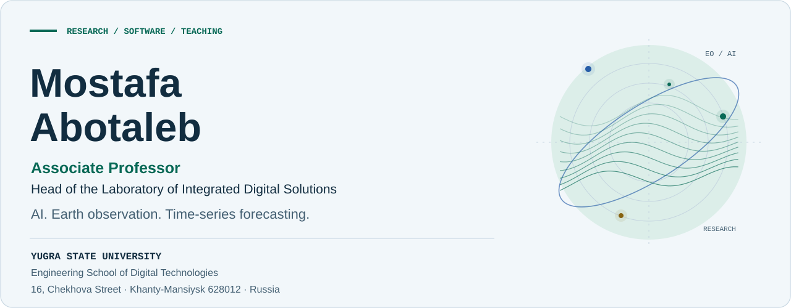
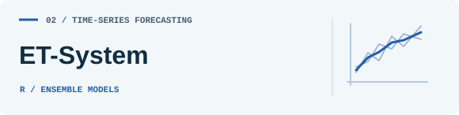
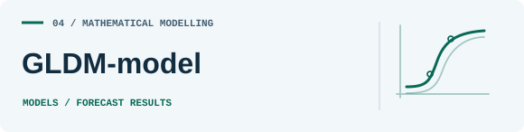

<picture>
  <source media="(max-width: 600px) and (prefers-color-scheme: dark)" srcset="assets/hero-mobile-dark.svg">
  <source media="(max-width: 600px)" srcset="assets/hero-mobile-light.svg">
  <source media="(prefers-color-scheme: dark)" srcset="assets/hero-dark.svg">
  <source media="(prefers-color-scheme: light)" srcset="assets/hero-light.svg">
  
</picture>

  <a href="#research-focus">Research</a> &nbsp; · &nbsp;
  <a href="#selected-projects">Projects</a> &nbsp; · &nbsp;
  <a href="#for-students">For students</a> &nbsp; · &nbsp;
  <a href="#contact">Contact</a>

I develop research software for Earth observation, time-series forecasting, and scientific computing. My work connects geospatial workflows, machine learning experiments, and mathematics education.

Engineering School of Digital Technologies · Yugra State University · Khanty-Mansiysk, Russia

<h2 id="research-focus">Research focus</h2>

| Area | Work |
| :--- | :--- |
| Earth observation & GIS | Satellite imagery, temporal scene selection, raster processing, and spectral indices in QGIS. |
| Forecasting & machine learning | Time-series models, neural networks, ensemble methods, and hyperparameter experiments. |
| Mathematics & education | Linear algebra, Wolfram Language programs, notebooks, and problems with solutions. |

<h2 id="selected-projects">Selected projects</h2>

<table>
<tr>
<td width="50%" valign="top">
<a href="https://github.com/abotalebmostafa11/EOChrono">
  <picture>
    <source media="(prefers-color-scheme: dark)" srcset="assets/eochrono-dark.svg">
    
  </picture>
</a>

QGIS plugin for satellite-scene discovery, temporal selection, download tracking, and raster processing.

<a href="https://github.com/abotalebmostafa11/EOChrono">Explore EOChrono</a> · <a href="https://github.com/abotalebmostafa11/EOChrono#installation">Installation</a>

</td>
<td width="50%" valign="top">
<a href="https://github.com/abotalebmostafa11/ET-System">
  <picture>
    <source media="(prefers-color-scheme: dark)" srcset="assets/ensemble-dark.svg">
    
  </picture>
</a>

Forecasting experiments that combine time-series and neural network models using ensemble methods.

<a href="https://github.com/abotalebmostafa11/ET-System">Explore ET-System</a> · <a href="https://github.com/abotalebmostafa11/ET-System/blob/main/E-System.R">R source</a>

</td>
</tr>
<tr>
<td width="50%" valign="top">
<a href="https://github.com/abotalebmostafa11/DL-System">
  <picture>
    <source media="(prefers-color-scheme: dark)" srcset="assets/deep-learning-dark.svg">
    
  </picture>
</a>

Python scripts and notebooks for LSTM, bidirectional LSTM, stacked LSTM, and GRU forecasting experiments.

<a href="https://github.com/abotalebmostafa11/DL-System">Explore DL-System</a> · <a href="https://github.com/abotalebmostafa11/DL-System/blob/main/DL_system.py">Python source</a>

</td>
<td width="50%" valign="top">
<a href="https://github.com/abotalebmostafa11/GLDM-model">
  <picture>
    <source media="(prefers-color-scheme: dark)" srcset="assets/gldm-dark.svg">
    
  </picture>
</a>

Modelling and forecast results for daily COVID-19 cases in Chelyabinsk, with GLDM and neural network folders.

<a href="https://github.com/abotalebmostafa11/GLDM-model">Explore GLDM-model</a> · <a href="https://github.com/abotalebmostafa11/Results_html">Results repository</a>

</td>
</tr>
<tr>
<td width="50%" valign="top">
<a href="https://github.com/abotalebmostafa11/Hyper-parameter-Tuning">
  <picture>
    <source media="(prefers-color-scheme: dark)" srcset="assets/tuning-dark.svg">
    
  </picture>
</a>

Hyperparameter tuning for LSTM disease-spread forecasting, with notebooks, model diagrams, and result plots.

<a href="https://github.com/abotalebmostafa11/Hyper-parameter-Tuning">Explore LSTM tuning</a> · <a href="https://github.com/abotalebmostafa11/Hyper-parameter-Tuning/blob/main/Hyper_parameter_Tuning.ipynb">Notebook</a>

</td>
<td width="50%" valign="top">
<a href="https://github.com/abotalebmostafa11/Linear-Algebra-Wolfram">
  <picture>
    <source media="(prefers-color-scheme: dark)" srcset="assets/linear-algebra-dark.svg">
    
  </picture>
</a>

Code accompanying three parts of a linear algebra course, with Wolfram notebooks and programs.

<a href="https://github.com/abotalebmostafa11/Linear-Algebra-Wolfram">Explore the course</a> · <a href="https://github.com/abotalebmostafa11/Linear-Algebra-Wolfram/tree/main/Part1">Start with Part 1</a>

</td>
</tr>
</table>

<a href="https://github.com/abotalebmostafa11?tab=repositories">Browse all repositories →</a>

<h2 id="for-students">For students</h2>

The <a href="https://github.com/abotalebmostafa11/Linear-Algebra-Wolfram">Linear Algebra collection</a> contains 360 problems with solutions and 667 code blocks across three parts. Each part includes Wolfram notebooks and source programs.

| Part | Material | Open |
| :--- | :--- | :--- |
| 1 | 9 chapters · 135 problems · 243 code blocks | [Part 1](https://github.com/abotalebmostafa11/Linear-Algebra-Wolfram/tree/main/Part1) |
| 2 | 8 chapters · 120 problems · 217 code blocks | [Part 2](https://github.com/abotalebmostafa11/Linear-Algebra-Wolfram/tree/main/Part2) |
| 3 | 7 chapters · 105 problems · 207 code blocks | [Part 3](https://github.com/abotalebmostafa11/Linear-Algebra-Wolfram/tree/main/Part3) |

Follow the execution instructions in the course README before running the examples.

<h2>Tools across my repositories</h2>

Python · R · Wolfram Language · Jupyter · QGIS · PyQGIS · GDAL

<h2 id="contact">Contact</h2>

For research collaboration, software questions, and teaching materials, contact me at <a href="mailto:abotalebmostafa@bk.ru">abotalebmostafa@bk.ru</a>.

For a software issue, open an issue in the relevant project repository and include the steps needed to reproduce it. Citation information is available in <a href="https://github.com/abotalebmostafa11/EOChrono/blob/main/CITATION.cff">EOChrono's CITATION.cff</a>.

Mostafa Abotaleb · Research / Software / Teaching

